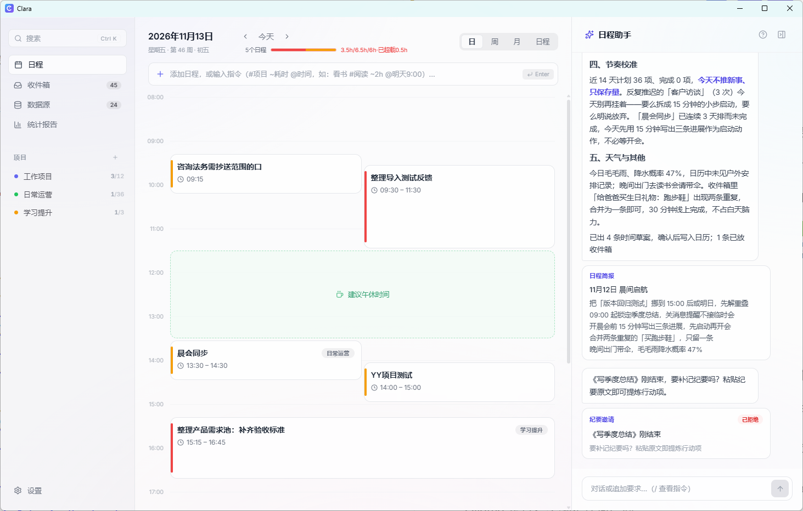
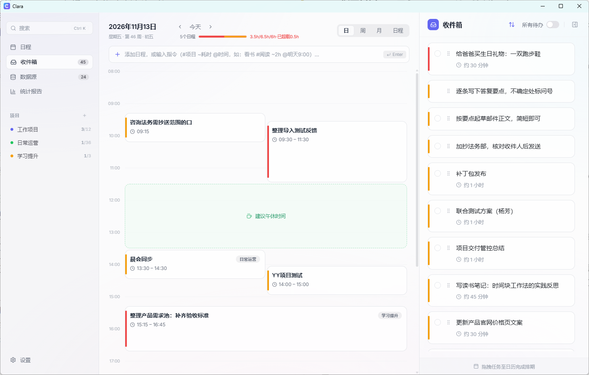
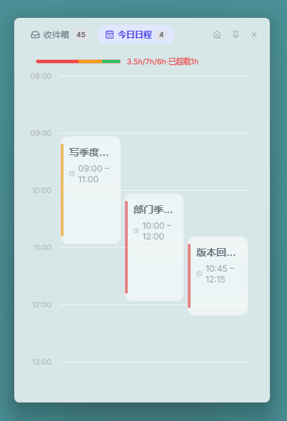
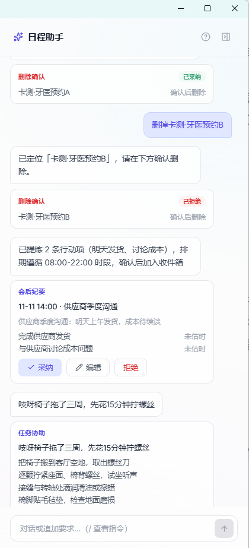
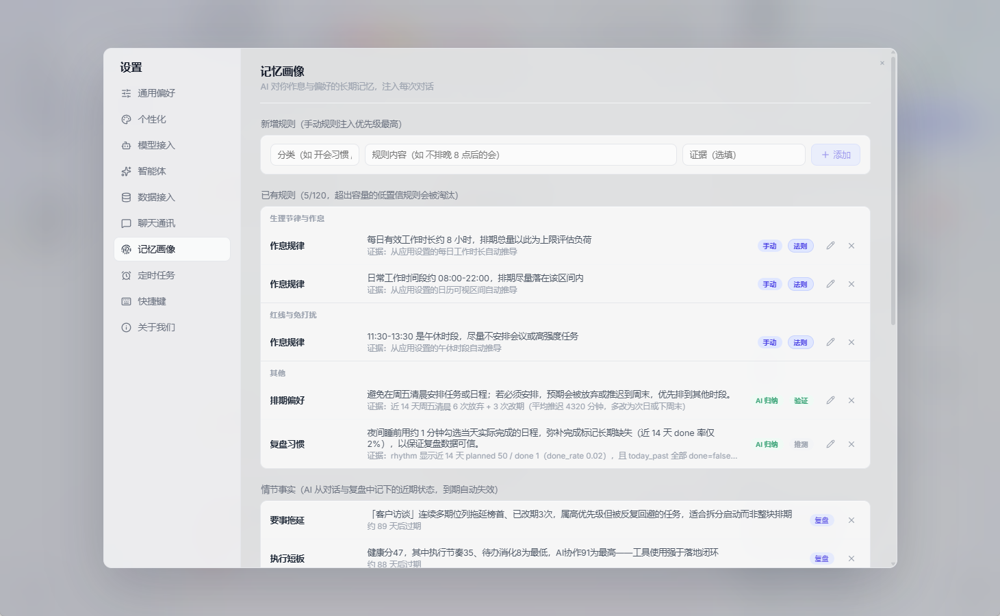
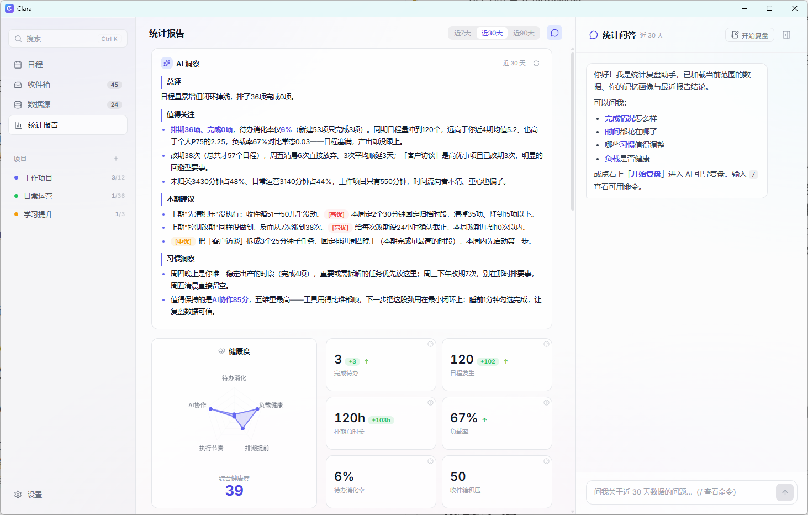
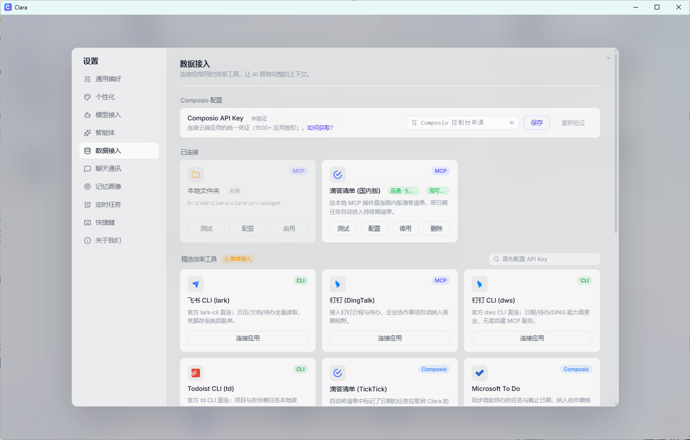
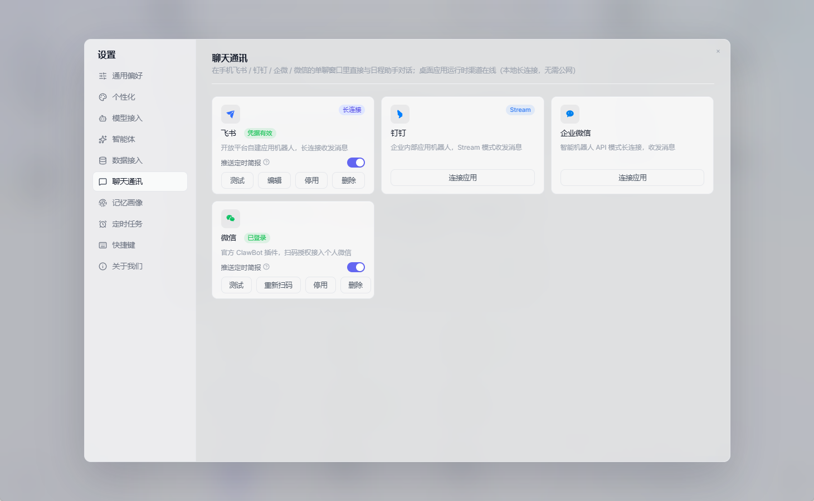
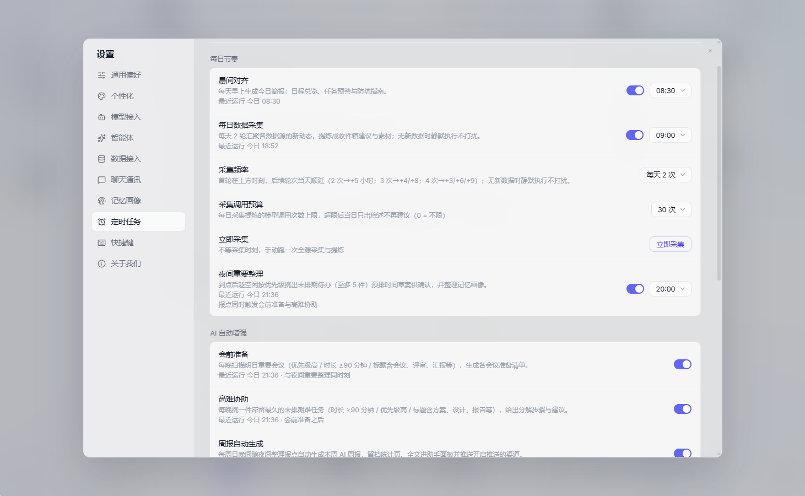
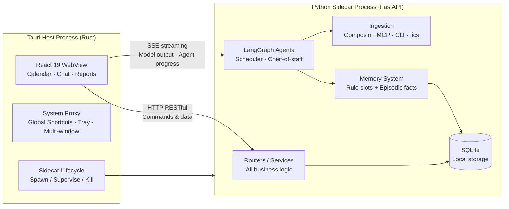

<p align="center">
  
</p>

<h1 align="center">Clara</h1>

<p align="center">A strategist for your time, not a taskmaster</p>

<p align="center">
  A local-first AI schedule assistant for your desktop — Clara plans the work with you, it doesn't do the work for you
</p>

<p align="center">
  [简体中文](README.md) · <strong>English</strong>
</p>

<p align="center">
  <a href="LICENSE"></a>
  <a href="https://github.com/HatBoy/Clara/releases"></a>
  <a href="https://github.com/HatBoy/Clara/releases"></a>
  <a href="backend/tests"></a>
  
  
  
</p>

<!-- 📸 Screenshot placeholder: main three-column layout (week view, showing sidebar + calendar + right panel). Drop the file into screenshots/ -->


## What is Clara

Clara is an AI schedule assistant that runs entirely on your own machine. It is not a do-everything AI — it is your **chief of staff for time**:

- **Plans the work, doesn't do the work** — writing code and decks is for other tools. Clara owns the upstream decisions: what happens when, how to avoid conflicts, and how to protect your peak hours for what matters
- **Local-first** — schedules, tasks, and memory live in a local SQLite database, never on someone else's cloud. Your model API keys never leave your machine
- **Model freedom** — powered by LiteLLM's unified protocol: OpenAI, Claude, DeepSeek, Qwen, GLM, Kimi… switch anytime, or run a local model via Ollama. No vendor lock-in
- **Gets smarter about you over time** — a two-tier memory system quietly learns your rhythm and preferences from how you drag, reschedule, and complete tasks, then consolidates overnight. No surveys to fill in

> Official releases currently ship a **Windows x64 installer**. macOS / Linux can be built from source (icon assets included) but are not officially tested.

## Core Features

### Calendar

A three-column layout: sidebar navigation, calendar in the middle, inbox and project to-dos on the right. Day / week / month views, drag-and-drop scheduling with stretch-to-resize, and full recurring-event support (timezone-aware, with drag semantics for instances).

<!-- 📸 Screenshot placeholder: day/week/month views (composite is fine) -->



- **Three-symbol quick add** — one line of text with `time`, `#tag`, and `@project` symbols, press Enter and it's scheduled: `"tomorrow 3pm Q3 review #deep-work @Alpha"`
- **Inbox & projects** — capture ideas into the inbox, grow them into projects, drag between columns, and one-click smart-schedule onto the calendar
- **Reminders** — SSE push + a dedicated always-on-top reminder window + sound cues that don't interrupt your flow
- **Desktop widget** — a compact today-at-a-glance panel that stays on your desktop, synced with the main window
- **Global shortcuts** — 16 actions, all customizable, reachable from any application
- **Unified search** — press `Ctrl+K` to search tasks and projects by title, notes, pinyin initials, or natural time phrases ("meetings next Wednesday")

### AI Agents

<!-- 📸 Screenshot placeholder: AI chat scheduling (streaming output + state machine progress) -->


- **Natural-language scheduling** — say "find time next week to review requirements with Mr. Zhang, mornings preferred". Clara parses intent, gathers context, then solves placement under a dozen hard constraints (conflict avoidance, overload protection, rhythm and buffer awareness) and confirms the draft with you
- **Chief-of-staff subgraph** — proactive coaching for seven scenario types: meeting prep, hard-task support, schedule review, and more. Not just recording your calendar — improving your decisions
- **Meeting minutes → action items** — paste meeting notes or a long chat thread; Clara extracts action items without ghost-writing them. Accept checked items into the inbox, or "accept & schedule" straight onto the calendar, with source traceability
- **Persona injection** — customize the chief of staff's tone and style
- **Streaming UX** — typewriter output with live state-machine progress ("reading email → extracting time → creating event")

### Memory System

<!-- 📸 Screenshot placeholder: Settings → memory profile page -->


- **Two-tier deterministic memory** — Tier 1 rule slots (rhythm / preferences / habits) plus a Tier 2 episodic fact store with Chinese full-text search. Scheduling and advice automatically draw on your profile
- **Behavioral telemetry** — drag trajectories, reschedules, rejected AI suggestions: this "behavioral exhaust" is silently distilled into rules ("this user prefers deep work in the morning")
- **Nightly reflection** — every night Clara reviews the day's behavior, consolidating new facts and revising stale rules. Zero manual check-ins required

### Reports

<!-- 📸 Screenshot placeholder: reports page, three columns -->


- **Overview band** — health radar, total-score trend line, six KPI tiles (period-over-period / baseline / personal-baseline alerts)
- **Where time went** — trend lines, time per project, priority distribution (honestly labeled as planned-duration accounting)
- **AI insights** — memory profile and personal percentile baselines feed pattern inference (important-task avoidance, optimistic estimation, …), applied only when evidence is strong
- **Periodic review** — a completion / abandoned / converted-to-todo checklist leads the review, and conclusions are distilled into facts that feed back into the scheduling assistant
- **StatsChatPanel** — a dedicated AI chat inside the reports page, with a guided-review mode for your week

### Data Ingestion

Four ingestion pipelines with incremental cursors and item-level settlement:

<!-- 📸 Screenshot placeholder: data sources page (suggestions second view) -->


- **Composio** — OAuth connections to cloud apps (email, calendar, to-dos, and more)
- **MCP** — a standard MCP client with curated templates and a built-in local-folder server
- **CLI tools** — a safety-gated executor for custom read-only commands
- **.ics import** — one-click calendar file import with fingerprint-based dedup
- Structured sources map directly with zero LLM calls; high-confidence items pass straight through, and the AI only refines when it genuinely adds value — saving tokens and guesswork

### Remote Channels

<!-- 📸 Screenshot placeholder: chat channels settings (Feishu/DingTalk/WeCom/WeChat) -->


Long-lived connections to Feishu, DingTalk, and WeCom, plus WeChat via QR login. Out and about? Text "schedule two hours tomorrow afternoon for the report" and Clara handles it. Sensitive operations like deletions require conversational confirmation — no accidental damage.

### Scheduled Jobs

Morning briefing, pre-meeting prep, hard-task support, the nightly three-in-one review, meeting-minutes invitations, and custom briefings — Clara reaches out on time, delivered through your connected chat channels.


## Why Clara

| | Clara | Cloud AI calendars | Traditional calendars |
|---|---|---|---|
| Data ownership | Local SQLite — yours, truly | Vendor servers | Local / vendor |
| Model lock-in | Any provider, switch anytime; local models welcome | Tied to one model | No AI |
| Personal memory | Two-tier memory + behavioral learning, compounds over time | Generic memory, hard to migrate | None |
| Privacy | Keys and data never leave your machine | Full cloud pipeline | Varies |
| Cost | Pay-per-token for your own model usage | Subscription | Free / subscription |

## Architecture

A dual-process design: **UI belongs to the UI layer, system integration to the host, data and computation to Python**.



| Layer | Technology |
|---|---|
| Frontend | React 19 · TypeScript · Vite |
| Host | Tauri 2 (Rust) · global shortcuts · system tray · multi-window (main / reminder / widget) |
| Backend | Python · FastAPI · SQLAlchemy 2.0 · SQLite (WAL) · PyInstaller sidecar |
| AI | LangGraph · LiteLLM · SSE streaming · dual-subgraph agents |
| Ingestion | Composio · MCP · CLI executor · icalendar |
| Messaging | Feishu lark-oapi · DingTalk dingtalk-stream · WeCom SDK · WeChat iLink |
| Quality | 1300+ pytest cases · zero-error frontend tsc |

## Getting Started

### Install (for users)

1. Download the latest `Clara_<version>_x64-setup.exe` from [Releases](https://github.com/HatBoy/Clara/releases)
2. Run the NSIS installer and launch
3. On first run, configure your model under **Settings → Model Providers**

### Configure a Model

Settings → Model Providers → Add: fill in a **Model ID** (LiteLLM prefix format) plus your **API Key**, run the connectivity test, then activate. Multiple providers can coexist with single activation, plus an optional auxiliary small-model slot.

| Category | Providers (Model ID prefixes) |
|---|---|
| International | `openai/` · `anthropic/` (Claude) · `gemini/` · `deepseek/` |
| China | `dashscope/` (Qwen) · `zai/` (GLM) · `moonshot/` (Kimi) · `volcengine/` (Doubao) · `minimax/` |
| Aggregators | `openrouter/` · `modelscope/` |
| Local | `ollama/` · `vllm/` · `lm_studio/` · `xinference/` and more |

> Any OpenAI-compatible endpoint (SiliconFlow, Baidu Qianfan, OneAPI relays, self-hosted gateways…) can be attached via the `openai/` prefix plus a Base URL.

## Developer Guide

### Prerequisites

- Node.js 20+ with npm
- Rust stable (with the MSVC toolchain)
- Python 3.11+ (a dedicated conda environment recommended)

### Run locally (two terminals)

```bash
# Terminal 1: Python backend (hot reload)
conda activate <your-env> && pip install -r backend/requirements.txt
cd backend && uvicorn main:app --host 127.0.0.1 --port 8000 --reload

# Terminal 2: Tauri / React frontend (project root)
npm install
npm run tauri dev
```

The dev database lives at `backend/data/clara.db` — delete it to reseed fresh data (`data/config_snapshot.json` is your user-config snapshot; don't delete that).

### Tests

```bash
conda activate <your-env> && cd backend && python -m pytest
```

### Build for release

```bash
npm run build:all    # PyInstaller sidecar → src-tauri/bin/, then tauri build
```

Output: `src-tauri/target/release/bundle/nsis/Clara_<version>_x64-setup.exe`. **After any backend change you must rerun `build:backend` before `tauri build`** (`build:all` chains this automatically).

### Project Layout

```text
├── src/                  # React frontend (components / lib / widget / reminder)
├── src-tauri/            # Tauri host (Rust: process mgmt · shortcuts · tray · windows)
├── backend/              # Python sidecar (FastAPI)
│   ├── main.py           # Entry: app assembly, CORS, router mounting
│   ├── services/         # Business logic layer (agents never query the DB directly)
│   ├── routers/          # Thin HTTP shell (decoding and status codes only)
│   ├── agents/           # LangGraph: dual subgraphs + unified scheduling engine + prompts
│   └── tests/            # 1300+ pytest cases
└── brand/                # Brand assets
```

## Contributing

Issues and PRs are welcome:

- Bug reports / feature requests: [Issues](https://github.com/HatBoy/Clara/issues)
- Code contributions: fork → branch → PR; keep `python -m pytest` fully green for backend changes

## License

[MIT](LICENSE) © 2026 HatBoy

## Acknowledgments

- [Tauri](https://tauri.app/) · [React](https://react.dev/) · [Vite](https://vitejs.dev/)
- [FastAPI](https://fastapi.tiangolo.com/) · [SQLAlchemy](https://www.sqlalchemy.org/) · [LangGraph](https://langchain-ai.github.io/langgraph/) · [LiteLLM](https://litellm.ai/)

---

<p align="center">Your strategist for time, on duty.</p>
