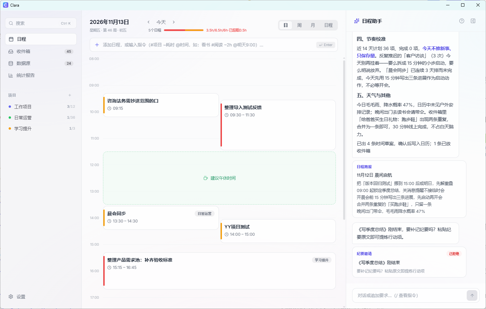
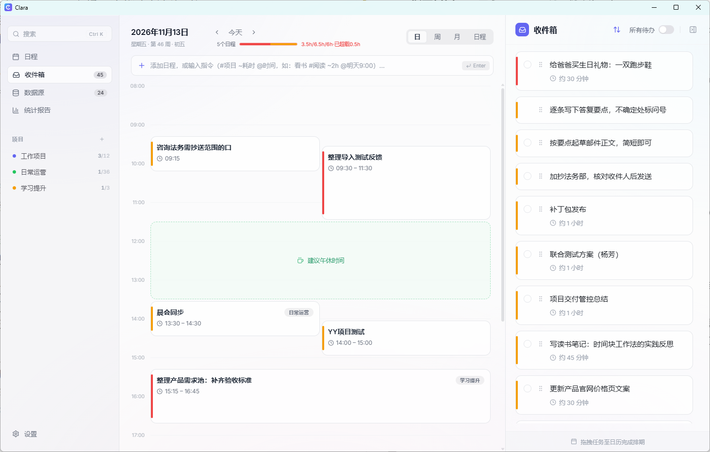
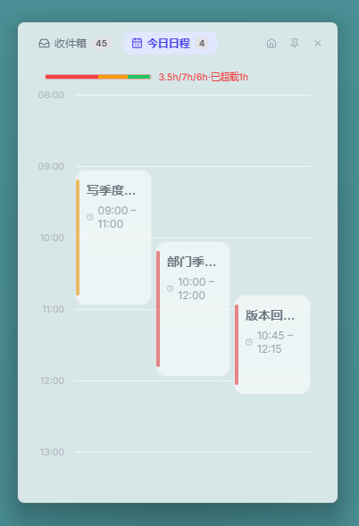
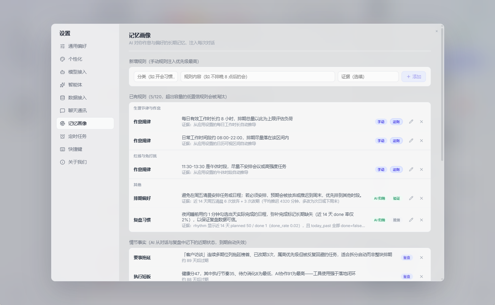
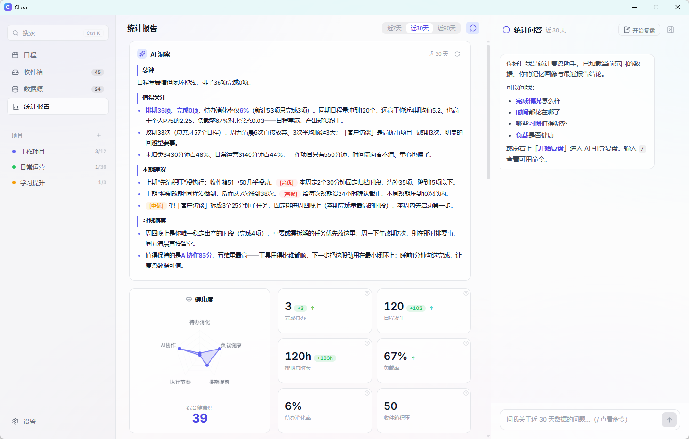
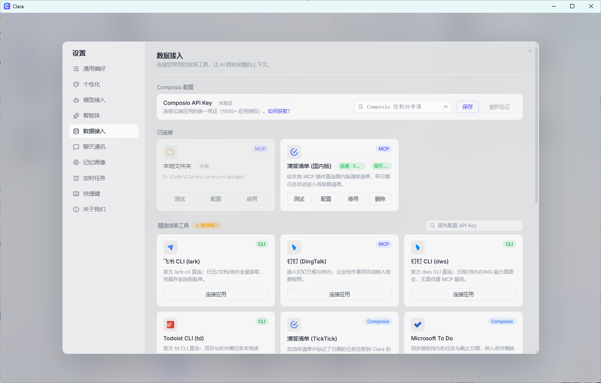
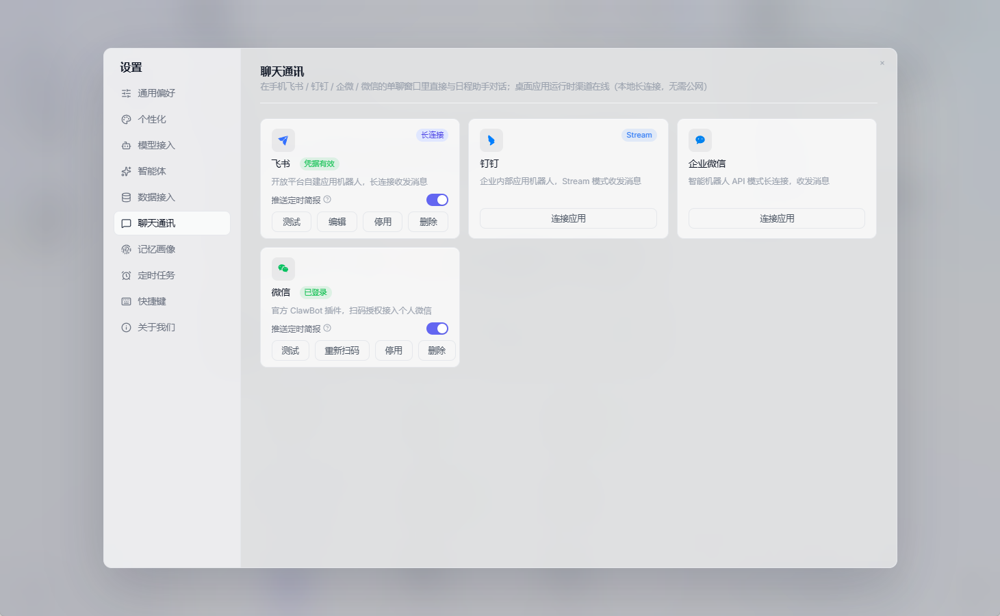
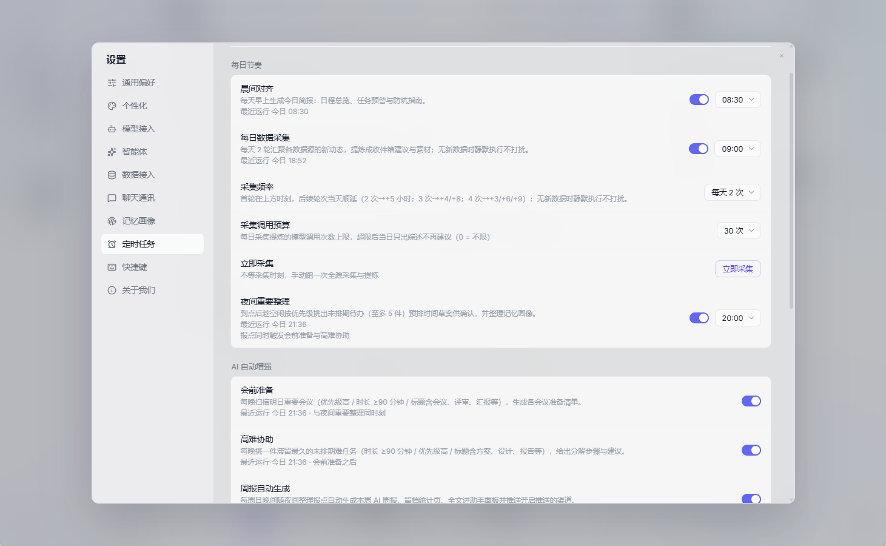
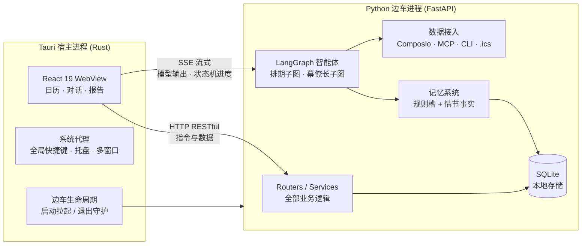

<p align="center">
  
</p>

<h1 align="center">Clara</h1>

<p align="center">做时间的策略师，不做任务的监工</p>

<p align="center">
  本地优先的 AI 日程助手桌面应用——帮你把活安排明白，而不是替你干活
</p>

<p align="center">
  <strong>简体中文</strong> · [English](README.en.md)
</p>

<p align="center">
  <a href="LICENSE"></a>
  <a href="https://github.com/HatBoy/Clara/releases"></a>
  <a href="https://github.com/HatBoy/Clara/releases"></a>
  <a href="backend/tests"></a>
  
  
  
</p>

<!-- 📸 截图占位：主界面三栏布局（建议周视图，展示侧栏 + 日历 + 右栏），文件放入 screenshots/ -->


## Clara 是什么

Clara 是一个跑在你自己电脑上的 AI 日程助手。它的定位不是"帮你干活的万能 AI"，而是**你的时间幕僚**：

- **安排活，不替你干活**——写代码、写 PPT 交给别的工具，Clara 负责更上游的事：什么时候干什么、怎么排不冲突、精力高峰留给要事
- **本地优先**——日程、任务、记忆全部存在本机 SQLite，不经过任何云端服务器；模型 API Key 只保存在你自己机器上
- **模型自由**——基于 LiteLLM 统一协议，OpenAI / Claude / DeepSeek / 通义 / 智谱 / Kimi……随便换，本地 Ollama 也行，不绑定任何厂商
- **越用越懂你**——双层记忆系统从你的拖拽、改期、完成行为中静默学习作息与偏好，夜间自动反思沉淀，不需要你填问卷

> 当前官方发布 **Windows x64 安装包**；macOS / Linux 可从源码自行构建（图标资源已备），但未经官方测试。

## 核心功能

### 日历核心

三栏布局，左侧导航 + 中间日历 + 右侧收件箱/项目待办。日 / 周 / 月三视图，拖拽排期与拉伸改时，重复日程完整支持（含时区感知与拖拽语义三问）。

<!-- 📸 截图占位：日/周/月三视图（可拼图） -->



- **三符号快捷录入**：一行文本带 `时间`、`#标签`、`@项目` 三种符号，Enter 直接入库——"明天下午3点 Q3 复盘 #深活 @Alpha"
- **收件箱与项目**：灵感先进收件箱，聚沙成塔进项目，右栏拖拽流转，一键智能安排上日历
- **提醒**：SSE 推送 + 独立置顶提醒小窗 + 提示音，不打断当前工作
- **桌面小部件**：常驻桌面的今日日程速览，与主窗双窗同步
- **全局快捷键**：16 个动作全部可自定义，任何应用里一按即达
- **统一搜索**：`Ctrl+K` 唤起，标题 / 备注 / 拼音首字母 / 时间词（"下周三的会"）混搜任务与项目

### AI 智能体

<!-- 📸 截图占位：AI 对话排期过程（流式输出 + 状态机进度） -->


- **自然语言排期**：聊天框里说"下周找个时间和张总过需求，上午最好"，AI 解析意图 → 读取上下文 → 排期引擎在**十余道硬约束**下求解（防冲突、防过载、尊重作息与缓冲），给出草案再确认
- **幕僚长子图**：会前准备、高难任务攻坚、日程复盘等七类场景的主动建议——不只是记录日程，而是拔高你的决策质量
- **会后纪要 → 行动项**：粘贴会议纪要或聊天长文，AI 只提炼不代笔；勾选采纳入收件箱，或"采纳并安排"直接上日历，来源可溯源回看
- **人格注入**：幕僚长的语气风格可自定义
- **流式体验**：打字机输出 + 状态机进度实时可见（"正在读取邮件 → 正在提取时间 → 正在创建日程"）

### 记忆系统

<!-- 📸 截图占位：设置-记忆画像页 -->


- **双层确定性记忆**：Tier 1 规则槽（作息 / 偏好 / 习惯）+ Tier 2 情节事实库（中文 FTS 检索），AI 排期与建议自动注入你的画像
- **行为遥测**：拖拽轨迹、改期、AI 建议被否决——这些"行为废气"被静默学习成规则（"该用户的高认知任务倾向上午"）
- **夜间反思**：每天夜里自动复盘当日行为，沉淀新事实、修正旧规则，无需任何手动打卡

### 统计报告

<!-- 📸 截图占位：统计报告页三栏 -->


- **总览带**：健康度雷达、总分趋势线、六格 KPI（环比 / 基线 / 个人基线预警）
- **时间去向**：趋势折线、项目花费、优先级分布（计划时长口径，诚实标注）
- **AI 洞察**：注入记忆画像与个人分位基线，行为模式推断（要事逃避、估时乐观等）宁缺毋滥
- **周期复盘**：完成 / 放弃 / 转待办三态打卡清单前置，复盘结论沉淀为事实反哺日程助手
- **StatsChatPanel**：报告页内独立 AI 对话，复盘引导模式陪你回顾这一周

### 数据接入

四路管道增量采集，条目级结算透明可查：

<!-- 📸 截图占位：数据源页（建议第二视图） -->


- **Composio**：云端应用 OAuth 接入（邮件、日历、待办等）
- **MCP**：标准 MCP 客户端 + 内地精选模板 + 本地文件夹内置服务端
- **CLI 工具**：自定义只读命令安全执行器
- **.ics 导入**：日历文件一键导入，指纹防重导
- 结构化数据零 LLM 直映射，高可信条目直通，AI 只在必要时提炼——省 token 也省心

### 远程渠道

<!-- 📸 截图占位：聊天通讯设置页（飞书/钉钉/企微/微信） -->


飞书 / 钉钉 / 企业微信长连接 + 微信扫码接入。人在外面，手机上发一句"明天下午安排两小时写报告"，Clara 就办了；删除日程等敏感操作走对话式确认，误伤不了。

### 定时任务

晨间简报、会前准备、高难任务陪跑、夜间三合一复盘、会后纪要邀请、自定义简报——到点主动找你，支持经聊天渠道推送。


## 为什么选 Clara

| | Clara | 云端 AI 日历 | 传统日历 |
|---|---|---|---|
| 数据归属 | 本地 SQLite，你的就是你的 | 厂商服务器 | 本地/厂商 |
| 模型绑定 | 任意厂商随时换，本地模型也行 | 绑定单一模型 | 无 AI |
| 个人记忆 | 双层记忆 + 行为学习，越用越懂你 | 泛化记忆，难迁移 | 无 |
| 隐私 | API Key 与数据不出本机 | 全链路上云 | 取决于厂商 |
| 价格 | 自负模型调用费（用多少付多少） | 订阅制 | 免费/订阅 |

## 架构

双进程架构：**UI 归 UI，系统归系统，数据与计算归 Python**。



| 层 | 技术 |
|---|---|
| 前端 | React 19 · TypeScript · Vite |
| 宿主 | Tauri 2 (Rust) · 全局快捷键 · 系统托盘 · 多窗口（主窗 / 提醒窗 / 小部件） |
| 后端 | Python · FastAPI · SQLAlchemy 2.0 · SQLite (WAL) · PyInstaller sidecar |
| AI | LangGraph · LiteLLM · SSE 流式 · 双子图智能体 |
| 数据接入 | Composio · MCP · CLI 执行器 · icalendar |
| 通讯 | 飞书 lark-oapi · 钉钉 dingtalk-stream · 企微 SDK · 微信 iLink |
| 质量 | pytest 1300+ 用例 · 前端 tsc 零错误 |

## 快速开始

### 安装（普通用户）

1. 从 [Releases](https://github.com/HatBoy/Clara/releases) 下载最新的 `Clara_<version>_x64-setup.exe`
2. 双击安装（NSIS 安装包），启动即用
3. 首次使用前往 **设置 → 模型接入** 配置你的模型

### 配置模型

设置 → 模型接入 → 添加供应商：填 **Model ID**（LiteLLM 前缀格式）+ **API Key**，点连通性测试，通过后激活即可。支持多供应商共存、单选激活，另有可选辅助小模型槽。

| 类别 | 供应商（Model ID 前缀） |
|---|---|
| 国际 | `openai/` · `anthropic/`（Claude）· `gemini/` · `deepseek/` |
| 国内 | `dashscope/`（通义）· `zai/`（智谱 GLM）· `moonshot/`（Kimi）· `volcengine/`（豆包）· `minimax/` |
| 聚合 | `openrouter/` · `modelscope/` |
| 本地 | `ollama/` · `vllm/` · `lm_studio/` · `xinference/` 等 |

> 任何 OpenAI 协议兼容端点（SiliconFlow、百度千帆、OneAPI 中转、自建网关……）都可以用 `openai/` 前缀 + Base URL 接入。

## 开发者指南

### 环境要求

- Node.js 20+ 与 npm
- Rust stable（含 MSVC 工具链）
- Python 3.11+（推荐 conda 独立环境）

### 本地运行（两个终端）

```bash
# 终端 1：Python 后端（热重载）
conda activate <你的环境> && pip install -r backend/requirements.txt
cd backend && uvicorn main:app --host 127.0.0.1 --port 8000 --reload

# 终端 2：Tauri / React 前端（项目根目录）
npm install
npm run tauri dev
```

dev 数据库在 `backend/data/clara.db`，删掉即按当天重新生成种子数据（`data/config_snapshot.json` 是用户配置快照，勿删）。

### 测试

```bash
conda activate <你的环境> && cd backend && python -m pytest
```

### 打包发布

```bash
npm run build:all    # 先 PyInstaller 编边车 → src-tauri/bin/，再 tauri build
```

产物：`src-tauri/target/release/bundle/nsis/Clara_<version>_x64-setup.exe`。**改过后端必须重跑 `build:backend` 再 tauri build**（`build:all` 已自动串联）。

### 项目结构

```text
├── src/                  # React 前端（components / lib / widget / reminder）
├── src-tauri/            # Tauri 宿主（Rust：进程管理 · 快捷键 · 托盘 · 多窗口）
├── backend/              # Python 边车（FastAPI）
│   ├── main.py           # 入口：装配 app、CORS、挂载 routers
│   ├── services/         # 业务逻辑层（AI 不越层直查库）
│   ├── routers/          # HTTP 薄壳（只做编解码与状态码）
│   ├── agents/           # LangGraph：双子图 + 统一排期引擎 + prompts
│   └── tests/            # pytest 1300+ 用例
└── brand/                # 品牌资源
```

## 参与贡献

欢迎 Issue 与 PR：

- Bug 报告 / 功能建议：[Issues](https://github.com/HatBoy/Clara/issues)
- 代码贡献：Fork → 分支开发 → PR；后端改动请保证 `python -m pytest` 全绿

## 许可证

[MIT](LICENSE) © 2026 HatBoy

## 致谢

- [Tauri](https://tauri.app/) · [React](https://react.dev/) · [Vite](https://vitejs.dev/)
- [FastAPI](https://fastapi.tiangolo.com/) · [SQLAlchemy](https://www.sqlalchemy.org/) · [LangGraph](https://langchain-ai.github.io/langgraph/) · [LiteLLM](https://litellm.ai/)

---

<p align="center">时间策略师，已在岗。</p>
